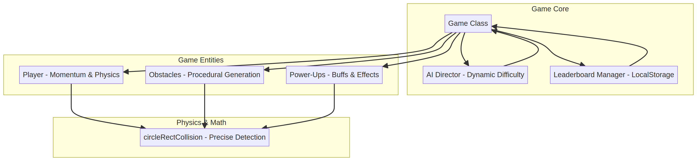
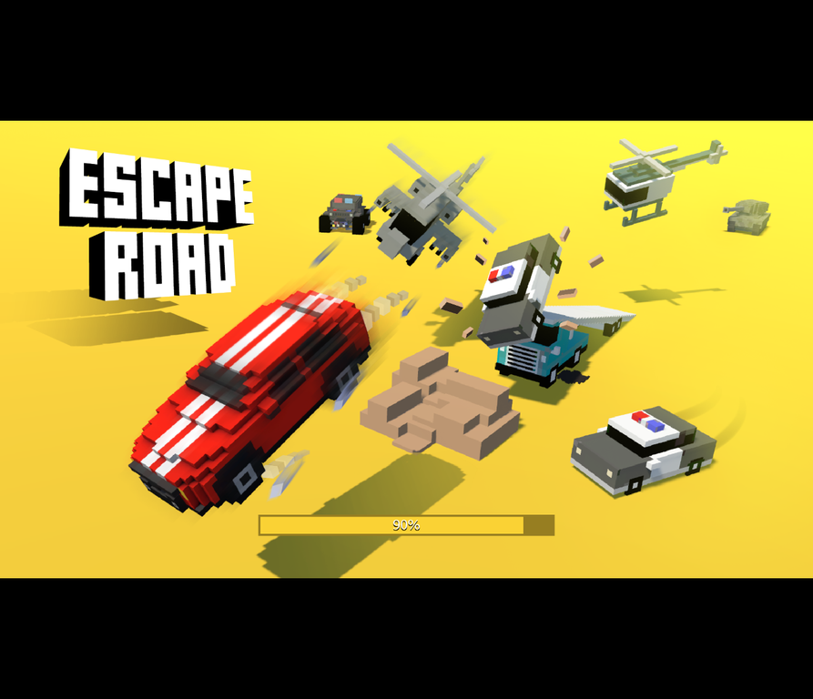
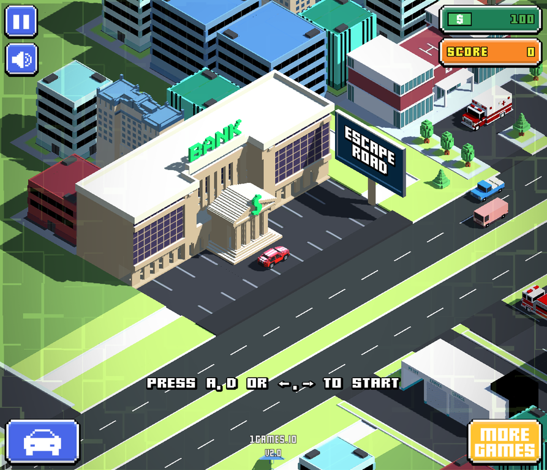

# 🏎️ Escape Road Game

**Escape Road Game** is a fast-paced, addictive arcade survival game where you navigate through busy city streets, dodging obstacles and collecting rewards. This project showcases **custom-built game logic in Vanilla JavaScript**, featuring advanced physics, dynamic difficulty, and procedural generation algorithms.

---

## 🏗️ Architecture

The project is built with a modular Object-Oriented approach in JavaScript, combining sophisticated game mechanics with an engaging visual experience.



### **Custom JavaScript Logic Highlights**
- **Advanced Physics Engine**: Implements momentum, inertia, friction, and precise circle-to-rectangle collision detection (`circleRectCollision` function).
- **Adaptive AI Director**: A dynamic difficulty system that monitors player performance and adjusts "Threat Levels" in real-time, making the game progressively harder.
- **Procedural Generation**: Obstacles and patterns are generated using weighted random algorithms to ensure a unique experience every playthrough.
- **Game Feel Mechanics**: Includes "Coyote Time" and "Jump Buffering" for responsive and professional gameplay.
- **Persistence System**: LocalStorage-based leaderboard to track high scores across sessions.

### **Visual Assets**
> The game uses professionally designed 3D models, voxel art, and UI elements. However, **all core gameplay logic, physics calculations, AI systems, and procedural generation algorithms were custom-written in JavaScript** to deliver a unique and optimized gaming experience.

---

## 📸 Screenshots

### **Loading Screen**
Beautiful loading animation with the iconic Escape Road branding.


### **Main Menu**
Clean and intuitive interface showcasing the game's vibrant aesthetic.


### **Active Gameplay**
Fast-paced action with dynamic obstacles, collectibles, and real-time scoring.


### **Game Over & Rewards**
Engaging end-game screen with achievement rewards and leaderboard integration.


---

## 🚀 Key Features
- **Dynamic Difficulty**: AI-driven threat system that adapts to player skill.
- **Procedural Obstacle Generation**: Weighted random patterns ensure variety and challenge.
- **Smooth Physics**: Realistic momentum, gravity, and collision response.
- **Power-Up System**: Collect bonuses for score multipliers, shields, and time manipulation.
- **Responsive Design**: Optimized for desktop and mobile browsers.
- **High Score Tracking**: Persistent leaderboard using LocalStorage.

---

## 🛠️ Getting Started

### **Play Online**
Visit the live deployment: **[https://escape-road-game-ten.vercel.app/](https://escape-road-game-ten.vercel.app/)**

### **Run Locally**
1. Clone the repository:
   ```bash
   git clone https://github.com/YOUR_USERNAME/escaperoad-game.git
   cd escaperoad-game
   ```
2. Open `index.html` in your browser to play the JavaScript version.
3. (Optional) Open `unity_shell.html` to view the original asset-based shell.

---

## 🎮 Controls
- **Move Left/Right**: `A` / `D` or `Arrow Keys`
- **Jump**: `Space`
- **Double Jump/Air Control**: Physics-based air movement
- **Goal**: Survive as long as possible, dodge obstacles, and collect power-ups!

---

## 💻 Technical Stack
- **Frontend**: Vanilla JavaScript (ES6+)
- **Rendering**: HTML5 Canvas
- **Physics**: Custom collision detection and response system
- **Deployment**: Vercel
- **Storage**: LocalStorage for persistent leaderboard

---

## 📝 License
This project is licensed under the MIT License.

---

## 🎯 Development Notes
The game demonstrates advanced game development concepts including:
- State management and game loops
- Physics simulation and collision detection
- AI/procedural generation algorithms
- Performance optimization through object pooling
- Responsive UI and game feel design
