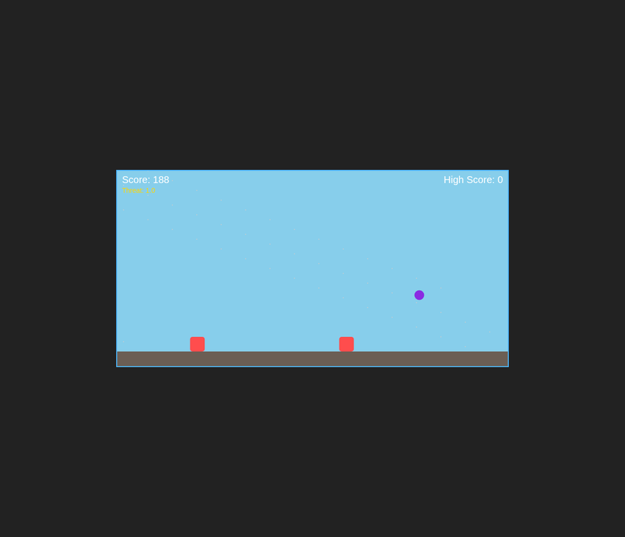
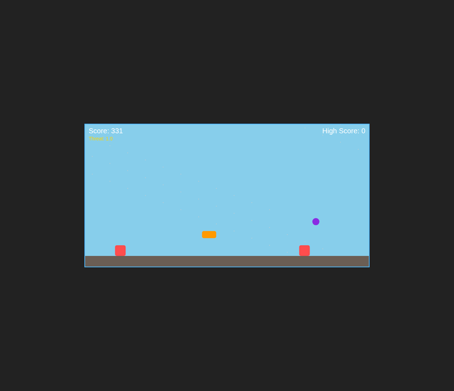

# 🏎️ Escape Road Game

**Escape Road Game** is a fast-paced arcade survival game. This project showcases a custom-built game logic implementation in Vanilla JavaScript, featuring advanced physics, dynamic difficulty, and procedural generation.

---

## 🏗️ Architecture

The project is built with a modular Object-Oriented approach in JavaScript.


### **Key Technical Features**
- **Custom Physics Engine**: Implements momentum, inertia, friction, and precise circle-to-rectangle collision detection.
- **Adaptive AI Director**: A dynamic difficulty system that monitors player performance and adjusts "Threat Levels" in real-time.
- **Procedural Generation**: Obstacles and patterns are generated using weighted random algorithms to ensure a unique experience every run.
- **Game Feel Mechanics**: Includes "Coyote Time" and "Jump Buffering" for a responsive and professional gameplay experience.
- **Persistence**: A LocalStorage-based leaderboard system to track high scores.

---

## 📸 Screenshots

### **Gameplay Preview**
The game features a clean, responsive 2D environment with smooth animations and parallax effects.




---

## 🚀 Project Context
> **Note on Assets**: The visual theme, models, and initial templates used in this project are based on ready-made game assets. However, the **entire core logic, physics, AI systems, and gameplay mechanics** were custom-written in JavaScript to provide a unique and optimized experience.

---

## 🛠️ Getting Started

### **Prerequisites**
- Any modern web browser.

### **How to Run**
1. Clone the repository:
   ```bash
   git clone https://github.com/YOUR_USERNAME/escaperoad-game.git
   ```
2. Open `index.html` in your browser to play the JavaScript version.
3. (Optional) Open `unity_shell.html` to view the original asset-based shell.

---

## 🎮 Controls
- **Jump**: Press `SPACE`.
- **Double Jump/Air Control**: Physics-based air movement.
- **Goal**: Survive as long as possible while dodging obstacles and collecting power-ups!

---

## 📝 License
This project is licensed under the MIT License.
